#  Lab: Multilayer Switching (Inter-VLAN Routing with SVIs)

A Cisco Packet Tracer lab where inter-VLAN routing moves from a router (router-on-a-stick) to a Layer 3 switch using SVIs and a routed point-to-point link to the edge router.

## Skills Demonstrated

- VLANs and 802.1Q trunking
- Subnetting: /26 host networks and a /30 link
- Layer 3 switching with SVIs (`ip routing`)
- Routed ports (`no switchport`)
- Static default routing
- Verification and troubleshooting with `show` commands and ping

## Objectives

1. Replace the router-on-a-stick configuration on R1 and SW2 with a point-to-point Layer 3 connection.
2. Configure one SVI per VLAN on SW2, using the last usable IP of each subnet.
3. Add a default route on SW2 with R1's G0/0 as the next hop.
4. Test inter-VLAN connectivity.
5. Test connectivity to the Internet by pinging 1.1.1.1.

## Topology

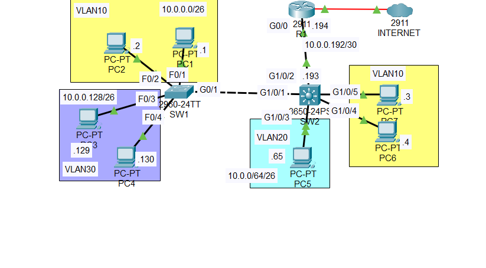

Devices: SW1 (2960-24TT, Layer 2), SW2 (3650-24PS, Layer 3), R1 (2911, edge router).

## Addressing Plan

| VLAN | Subnet | Gateway (SVI on SW2) | Hosts |
|------|--------|----------------------|-------|
| 10 | 10.0.0.0/26 | 10.0.0.62 | PC1 (.1), PC2 (.2), PC7 (.3), PC6 (.4) |
| 20 | 10.0.0.64/26 | 10.0.0.126 | PC5 (.65) |
| 30 | 10.0.0.128/26 | 10.0.0.190 | PC3 (.129), PC4 (.130) |
| Link | 10.0.0.192/30 | SW2 G1/0/2 = .193, R1 G0/0 = .194 | Point-to-point |

## Port Map

| Device | Port | Connects to |
|--------|------|-------------|
| SW1 | F0/1, F0/2 | PC1, PC2 (VLAN 10) |
| SW1 | F0/3, F0/4 | PC3, PC4 (VLAN 30) |
| SW1 | G0/1 | SW2 G1/0/1 (trunk) |
| SW2 | G1/0/2 | R1 G0/0 (routed port) |
| SW2 | G1/0/3 | PC5 (VLAN 20) |
| SW2 | G1/0/4, G1/0/5 | PC6, PC7 (VLAN 10) |

## Starting Point

Hosts were already in the correct VLANs, SW1 and SW2 were connected by a trunk, and R1 routed between VLANs with subinterfaces on G0/0:

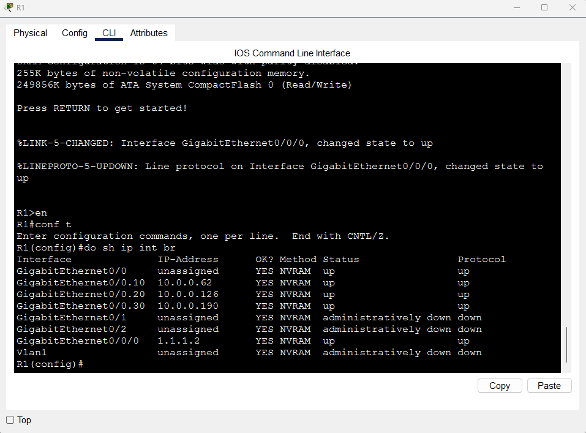

## Configuration

Full command lists are in [`configs/R1.txt`](configs/R1.txt) and [`configs/SW2.txt`](configs/SW2.txt).

### Step 1: R1, remove ROAS and create the point-to-point link

```
no interface g0/0.10
no interface g0/0.20
no interface g0/0.30
interface g0/0
 ip address 10.0.0.194 255.255.255.252
```

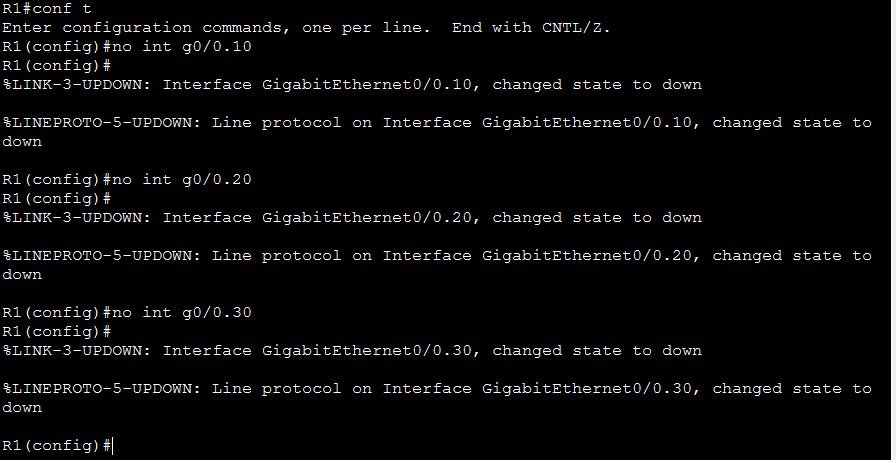
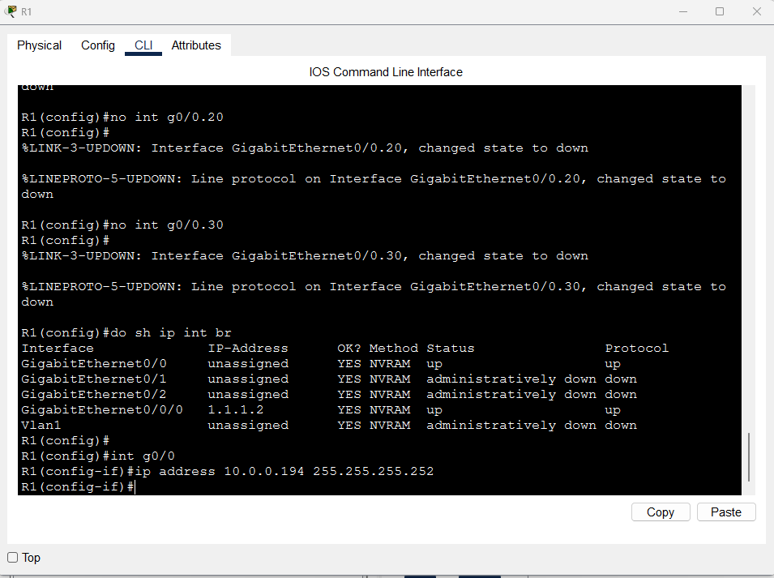

### Step 2: SW2, routed port and Layer 3 routing

```
interface g1/0/2
 no switchport
 ip address 10.0.0.193 255.255.255.252
ip routing
```

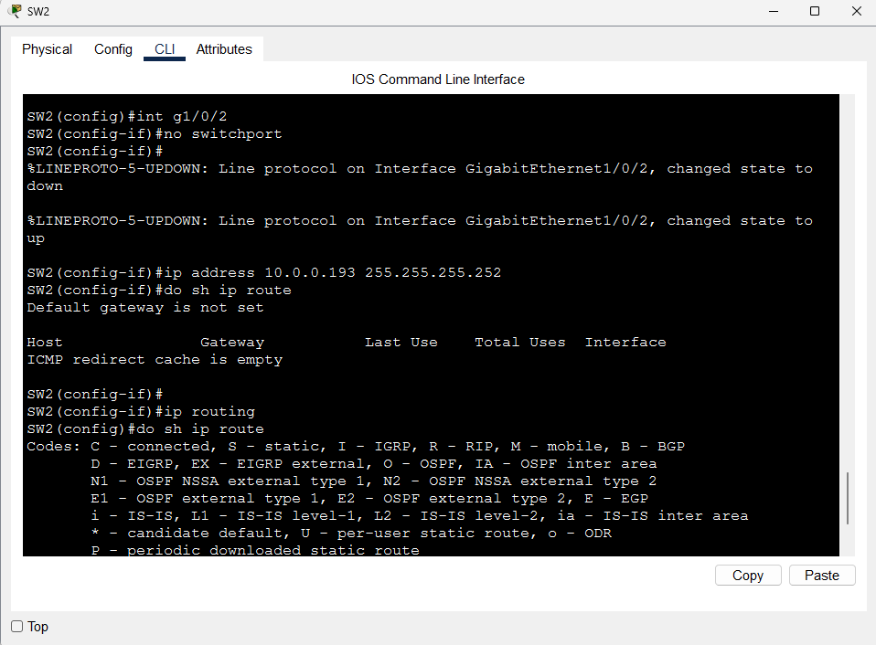

### Step 3: SW2, SVIs

```
interface vlan 10
 ip address 10.0.0.62 255.255.255.192
interface vlan 20
 ip address 10.0.0.126 255.255.255.192
interface vlan 30
 ip address 10.0.0.190 255.255.255.192
```

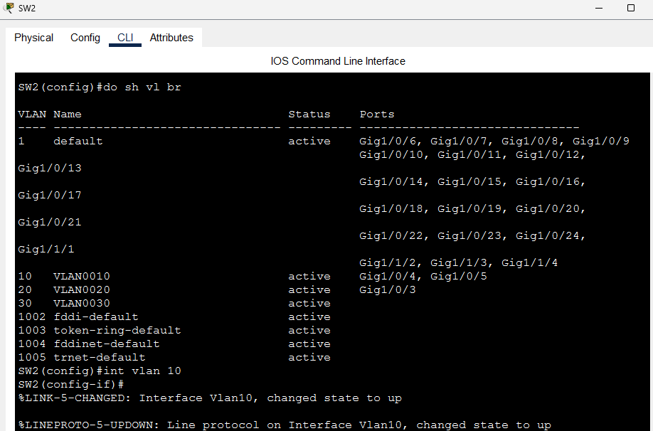
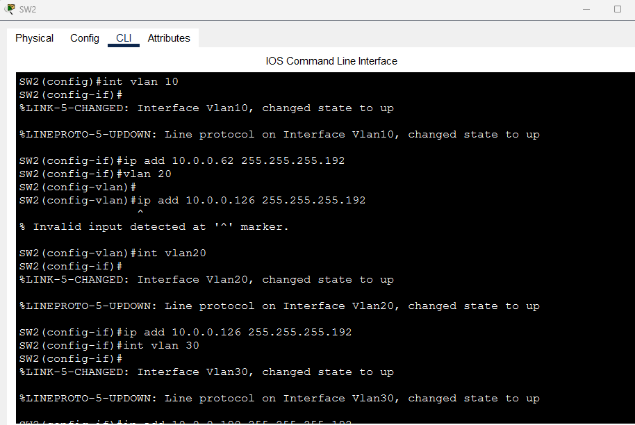

### Step 4: SW2, default route to R1

```
ip route 0.0.0.0 0.0.0.0 10.0.0.194
```

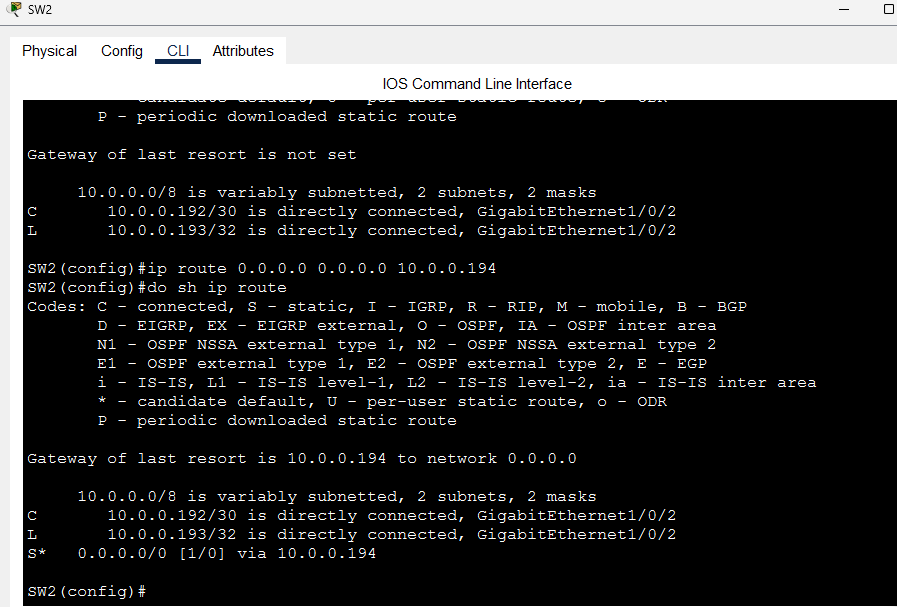

## Verification

`show ip interface brief` on SW2 shows the routed port (G1/0/2 = 10.0.0.193) and all three SVIs up/up:

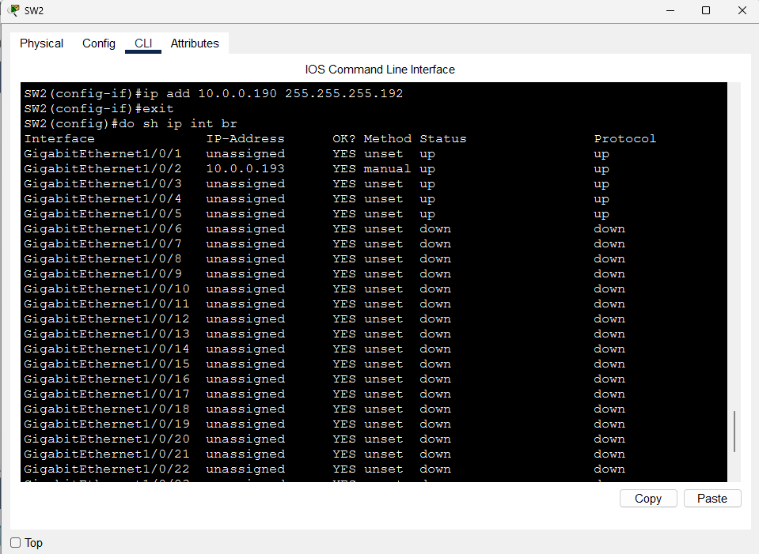
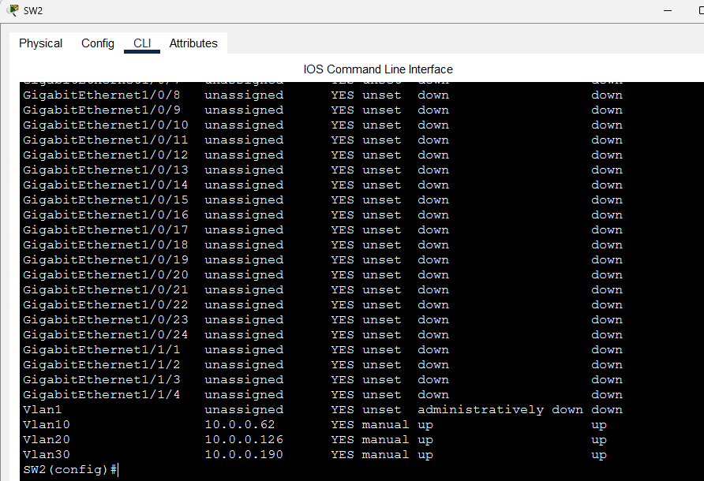

`show ip route` shows the default route (`S*`) via 10.0.0.194.

### Connectivity tests

| Test | Source | Destination | Result |
|------|--------|-------------|--------|
| Inter-VLAN (VLAN 10 to VLAN 30, across SW1 and SW2) | PC7 | PC3 (10.0.0.129) | Success, 0% loss |
| Internet | PC7 | 1.1.1.1 | Reply received through R1 |

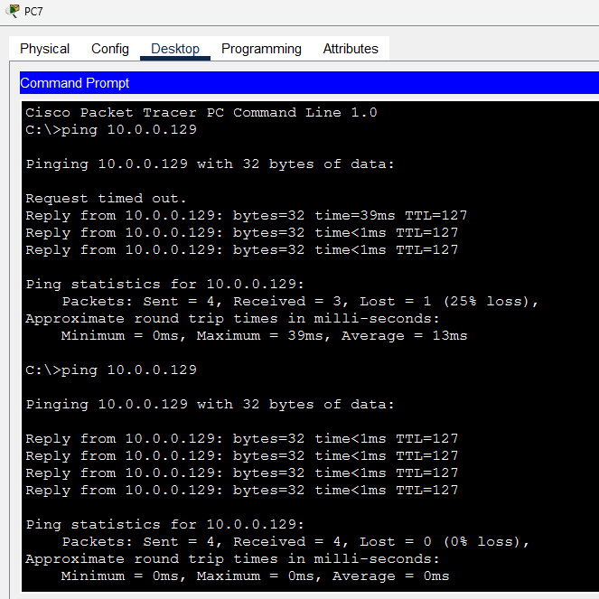
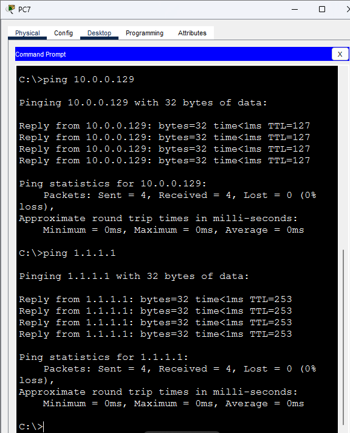

Notes on the results:

- The first ping often loses a packet while ARP resolves. The repeat ping has 0% loss.
- TTL=127 on the inter-VLAN reply shows the packet crossed one Layer 3 hop (SW2) from a 128 starting TTL.
- The reply from 1.1.1.1 (TTL=253) confirms traffic left through R1 using the default route.

## Troubleshooting Notes

- **`% Invalid input` when setting an SVI address:** I typed `ip address` while in VLAN config mode (`vlan 20`). SVI addresses go under `interface vlan 20`.
- **Routed port needs `no switchport` first** before it accepts an IP address.
- **SVI shows down/down:** the VLAN must exist on SW2 and have an active port.
- **No inter-VLAN routing:** check that `ip routing` is enabled.

## Key Takeaways

- A multilayer switch routes between VLANs directly, so traffic no longer funnels through a single trunk to a router.
- SVIs act as each VLAN's default gateway.
- A routed /30 link keeps the switch-to-router connection simple.

## Files

```
├── README.md
├── configs/
│   ├── R1.txt
│   └── SW2.txt
├── images/
└── Lab-Multilayer-Switching.pkt  
```
